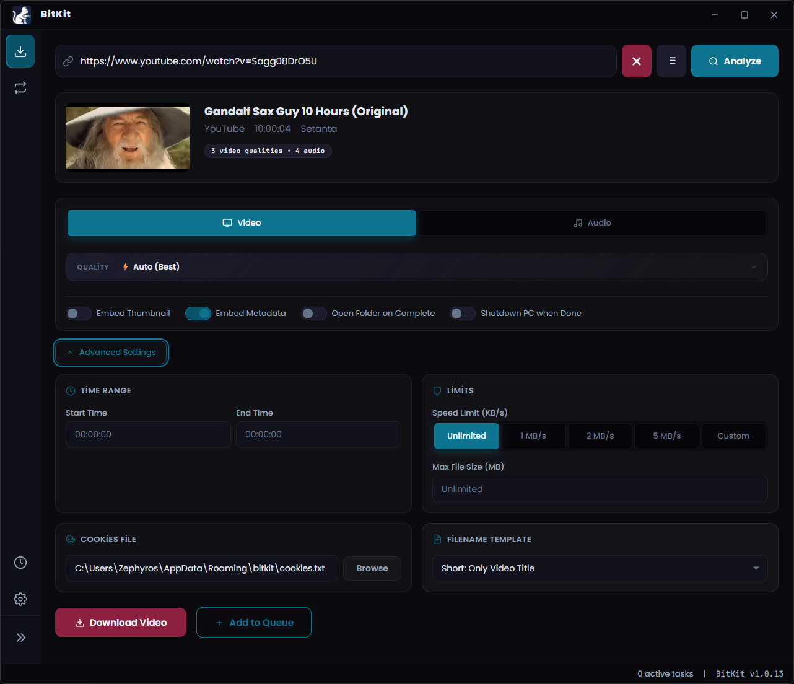
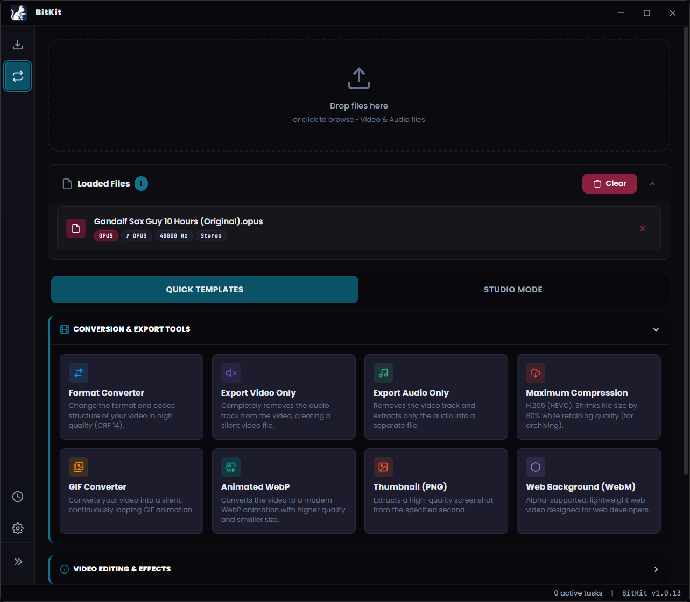
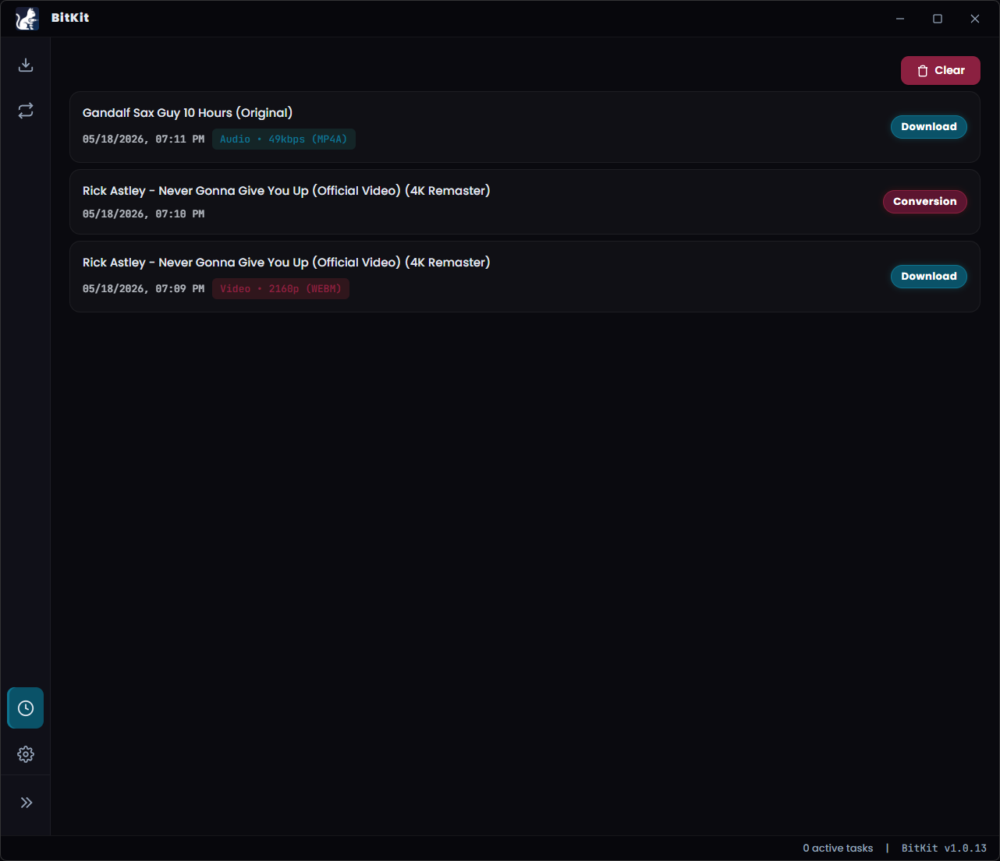
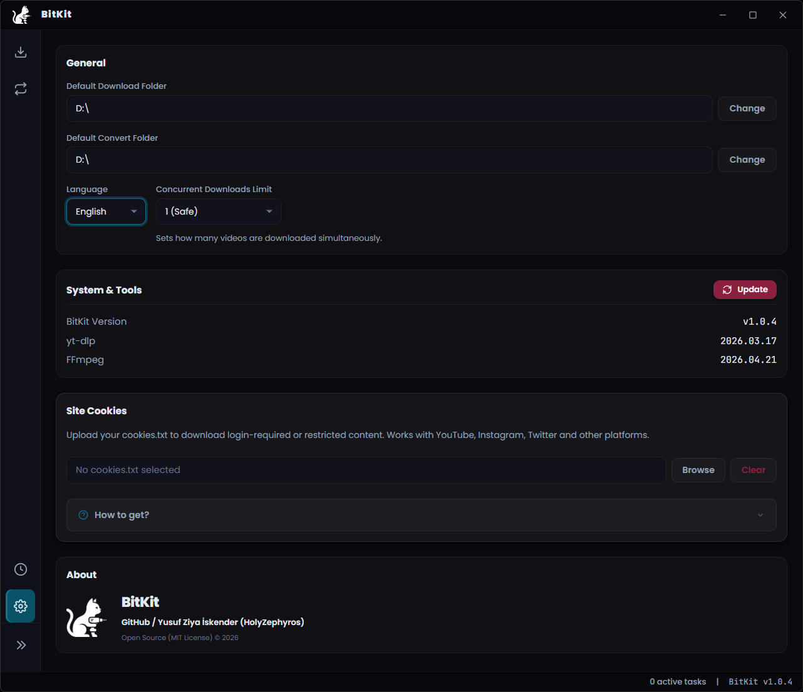

<p align="center">
  
</p>

<h1 align="center">BitKit</h1>

<p align="center">
  <b>Lightweight, native Rust media downloader & converter powered by Tauri v2, yt-dlp & FFmpeg</b>
</p>

<p align="center">
  
  
  
  
  
</p>

<p align="center">
  <a href="#-features">Features</a> •
  <a href="#-screenshots">Screenshots</a> •
  <a href="#-installation">Installation</a> •
  <a href="#-tech-stack">Tech Stack</a> •
  <a href="#-license">License</a>
</p>

---

## 🎯 What is BitKit?

BitKit is a fast, lightweight, privacy-focused Windows desktop application built with **Rust** and **Tauri v2** for downloading, converting, and processing media files. It wraps the full power of [yt-dlp](https://github.com/yt-dlp/yt-dlp) and [FFmpeg](https://github.com/FFmpeg/FFmpeg) behind a sleek, modern interface — no command line required.

---

## ✨ Features

### 📥 Downloader
- Download video & audio from **1000+ websites** (YouTube, Twitter/X, Instagram, TikTok, Reddit, and more)
- **Batch link mode** with background **clipboard auto-detection** & corner notification popup
- Full **playlist support** and live **global bandwidth rate limiting** via built-in Tokio Rust proxy
- Choose exact **video quality** (up to 8K), **audio bitrate**, and **output format**
- **Trim before download** — set start/end timestamps
- **Cookie support** for age-restricted or private content
- Embed **thumbnails** and **metadata** automatically

### 🔄 Converter
- Convert between all major formats: **MP4, MKV, WebM, AVI, MOV, MP3, FLAC, WAV, Opus, AAC** and more
- Full **codec control** (H.264, H.265/HEVC, VP9, AV1) with **hardware acceleration** (NVENC, QSV, AMF) and automatic CPU fallback
- Adjustable **CRF quality**, bitrate, resolution, FPS, and audio sample rate
- Native OS **drag & drop** directly into the app

### ⚡ Quick Templates (30+ Presets)
One-click presets for common tasks:

| Category | Templates |
|---|---|
| 🎬 **Format** | Smart Convert, Video Mute, Audio Extract, GIF, Animated WebP, WebM |
| ✂️ **Edit** | Trim, Timelapse, Slow Motion, Rotate, Reverse, Split |
| 🔊 **Audio** | Volume Boost, Loudness Normalize, Audio Denoise |
| 🎨 **Filters** | Denoise, Sharpen, Stabilize, Auto-Crop, HDR→SDR, Motion Interpolation |
| 📱 **Platform** | TikTok/Reels, Discord, WhatsApp |

Templates can be **combined** — stack multiple filters in a single pass.

### ⚙️ General
- Full **download & conversion history**
- **Multi-language** support (English, Turkish, Spanish, German, French, Russian, Italian, Portuguese, Polish, Japanese, Chinese)
- **Zero-UAC current-user installer** (LZMA compressed NSIS) & seamless **in-app auto-updater** with automatic relaunch
- Built-in **yt-dlp & FFmpeg updater**
- Custom output directories and filename templates

---

## 📸 Screenshots

<p align="center">
  
  <br><em>Downloader — Analyze and download from any URL</em>
</p>

<p align="center">
  
  <br><em>Converter — 30+ one-click Quick Templates</em>
</p>

<p align="center">
  
  <br><em>History — Track all downloads and conversions</em>
</p>

<p align="center">
  
  <br><em>Settings — Customize everything</em>
</p>

---

## 📦 Installation

### Download Release
1. Go to the [Releases](../../releases) page
2. Download the latest Windows `.exe` installer
3. Run the installer — installs for the current user with **no Administrator (UAC) prompt** and all media tools bundled

### Build from Source

**Prerequisites:** [Rust toolchain](https://rustup.rs/) (`rustc` & `cargo`), [Node.js](https://nodejs.org/) (for Tauri CLI), and WebView2 (pre-installed on Windows 10/11).

```bash
git clone https://github.com/HolyZephyros/BitKit.git
cd BitKit
npm install

# Download required binaries (yt-dlp, Deno & shared FFmpeg)
npm run fetch-bins

npm run dev       # Development mode (hot reload)
npm run build     # Build release binary + NSIS installer
```

---

## 🧰 Tech Stack

| Layer | Technology |
|---|---|
| **Backend & Core** | [Rust](https://www.rust-lang.org/) + [Tauri v2](https://v2.tauri.app/) ([Tokio](https://tokio.rs/) async runtime) |
| **Media Engine** | [yt-dlp](https://github.com/yt-dlp/yt-dlp) + [FFmpeg](https://github.com/FFmpeg/FFmpeg) (shared GPL) + [Deno](https://deno.com/) |
| **Frontend** | Vanilla HTML/CSS/JS (Windows WebView2) |
| **Packaging** | Tauri Bundler (NSIS LZMA, current-user) |

---

## 📄 License

The source code is licensed under the **MIT License** — see [LICENSE](LICENSE) for details.
